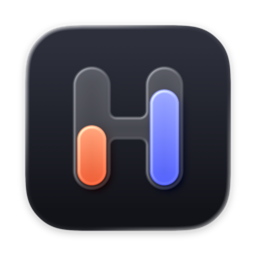
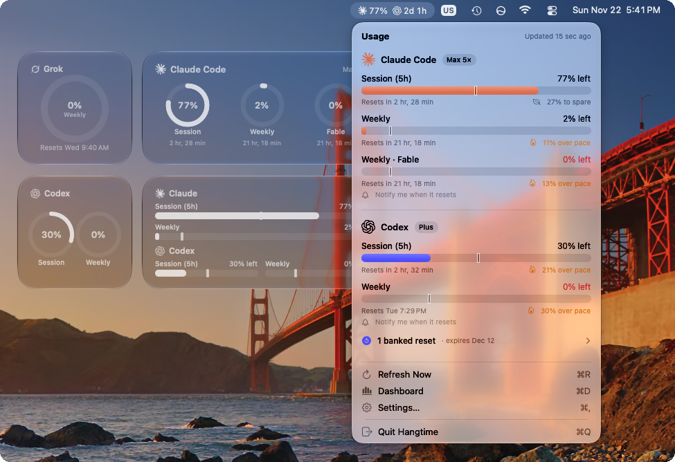
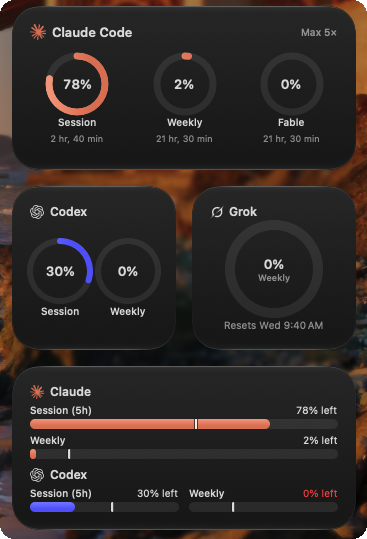
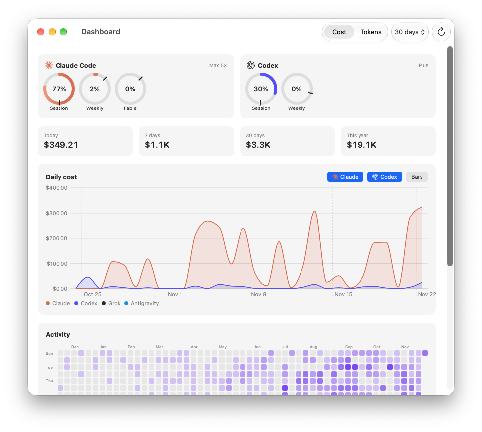

<p align="center">
  
</p>

<h1 align="center">Hangtime</h1>

<p align="center">
  See how much of your AI coding subscriptions you have <b>left</b>, right in your Mac's menu bar and widgets.<br>
  For <b>Claude Code</b>, <b>OpenAI Codex</b>, <b>Grok CLI</b> and <b>Google Antigravity</b>.
</p>

<p align="center">
  <a href="https://github.com/Sevi-py/hangtime/releases/latest"></a>
  <a href="https://github.com/Sevi-py/hangtime/releases"></a>
  
  <a href="https://github.com/Sevi-py/homebrew-tap"></a>
  <a href="https://github.com/Sevi-py/hangtime/actions/workflows/ci.yml"></a>
  <a href="LICENSE"></a>
</p>

<p align="center">
  <picture>
    <source media="(prefers-color-scheme: dark)" srcset="docs/images/hero-dark.png">
    
  </picture>
</p>

## Install

Requires macOS 26 (Tahoe) or later.

**Homebrew**

```sh
brew tap sevi-py/tap
brew trust --cask sevi-py/tap/hangtime   # Homebrew only loads casks from third-party taps you trust
brew install --cask sevi-py/tap/hangtime
```

**Download**: grab `Hangtime-<version>.dmg` from the [latest release](https://github.com/Sevi-py/hangtime/releases/latest),
open it and drag Hangtime to Applications. Builds are signed with Developer ID and notarized by Apple.

Hangtime keeps itself up to date (through `brew upgrade` if you installed it with Homebrew). You can turn that off
in Settings → General → Updates.

## Features

- **Menu bar**: what's left per provider, or only your tightest limit, as text or mini rings. Click it for a
  panel with every limit, when it resets, and quick actions.
- **Every limit the CLIs report**: Claude's session, weekly and per-model limits, Codex's windows, Grok's
  credits and Antigravity's model quotas. New limit types show up automatically.
- **Even-pace marker**: a tick on every bar shows where you'd be if you spread your usage evenly over the window,
  so you can tell at a glance whether you're ahead or behind.
- **Banked resets**: see your available Claude and Codex resets with their expiry, and redeem them (with
  confirmation).
- **Widgets** for the desktop and Notification Center (Provider Limits, All Providers, Single Limit, Usage Chart,
  Activity heatmap), plus a Control Center control.
- **Dashboard**: cost and token history, a year-long activity heatmap and a per-model breakdown.
- **Notifications** when a limit resets, runs low, a banked reset is about to expire, or a CLI gets signed out.
- **No terminal needed**: if a CLI is signed out, Hangtime offers a *Sign In…* button that runs the CLI's own
  login in your browser.

<p align="center">
  
  &nbsp;
  <picture>
    <source media="(prefers-color-scheme: dark)" srcset="docs/images/dashboard-dark.png">
    
  </picture>
</p>

## How it works

Hangtime has no server and no analytics. It reads each CLI's existing login and asks the provider for your
limits the same way the CLI does. It never refreshes tokens itself, so it never signs your CLIs out. Only CLIs
that are installed show up.

Details for each provider, the history sources and the network access are in
[docs/how-it-works.md](docs/how-it-works.md).

## Building from source

You need macOS 26, Xcode 26 and [XcodeGen](https://github.com/yonaskolb/XcodeGen) (`brew install xcodegen`).
`project.yml` is the source of truth; `Hangtime.xcodeproj` is generated from it.

```sh
git clone https://github.com/Sevi-py/hangtime.git
cd hangtime
xcodegen generate
open Hangtime.xcodeproj
```

The project is signed with the maintainer's team. To build with yours, set your team ID: change
`DEVELOPMENT_TEAM` in `project.yml` (then run `xcodegen generate` again), or pass it on the command line:

```sh
xcodebuild -project Hangtime.xcodeproj -scheme Hangtime -configuration Release \
  -derivedDataPath build -allowProvisioningUpdates DEVELOPMENT_TEAM=<YOUR_TEAM_ID> build
open build/Build/Products/Release/Hangtime.app
```

The app group that the app shares with its widgets is derived from the team ID, so widgets work with any team.
If you run your own build, turn off automatic updates in Settings → General → Updates; otherwise Hangtime
replaces it with the next official release.

`./scripts/install.sh` builds a Release version, replaces `/Applications/Hangtime.app` and reloads widgets you
have already placed. Run `xcodegen generate` after adding or removing files.

**Debug builds** have two diagnostic modes that don't touch the menu bar:

```sh
Hangtime --dump [--history]   # print everything it fetched as JSON
Hangtime --render <dir>       # render the panel, settings, Dashboard and widgets to PNGs
```

`--render` also takes `--providers claude,codex`, `--limits-provider <id>` and `--gauge-provider <id>`, and the
usual `-AppleLocale en_US` to render another locale. The binary is at
`Hangtime.app/Contents/MacOS/Hangtime`.

Maintainers: see [docs/RELEASING.md](docs/RELEASING.md) for how releases are built and published.

## License

[MIT](LICENSE). Provider logos come from [LobeHub Icons](https://github.com/lobehub/lobe-icons) (MIT) and are
trademarks of their owners.
